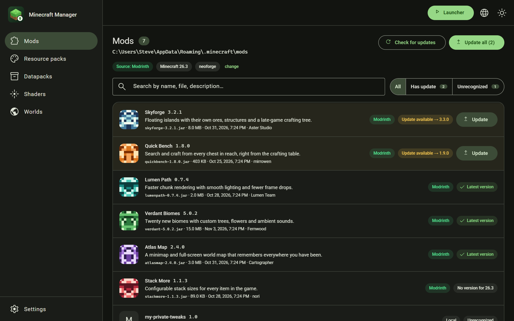
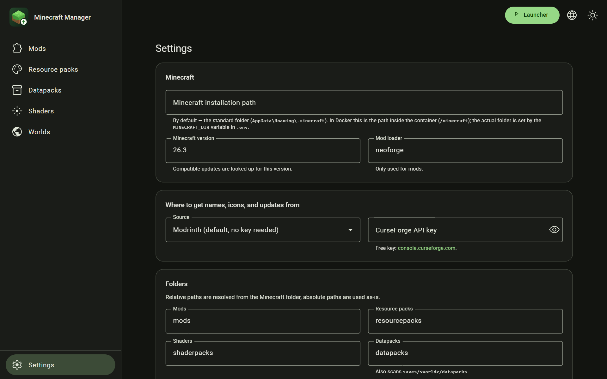
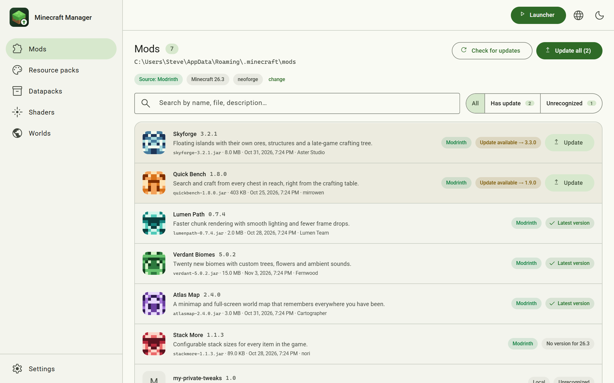
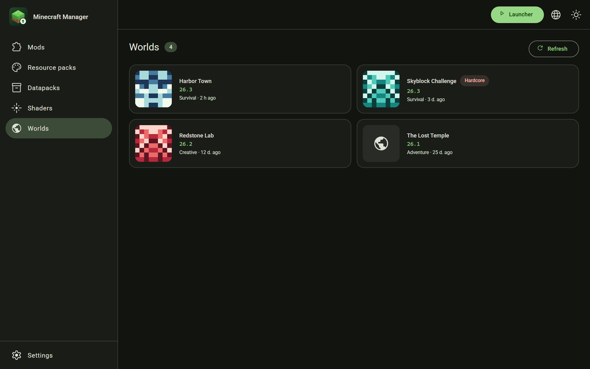
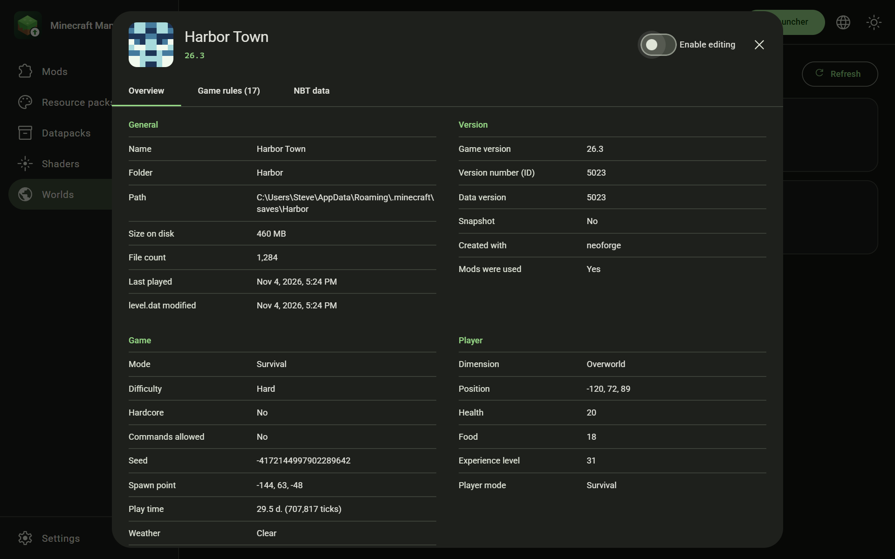
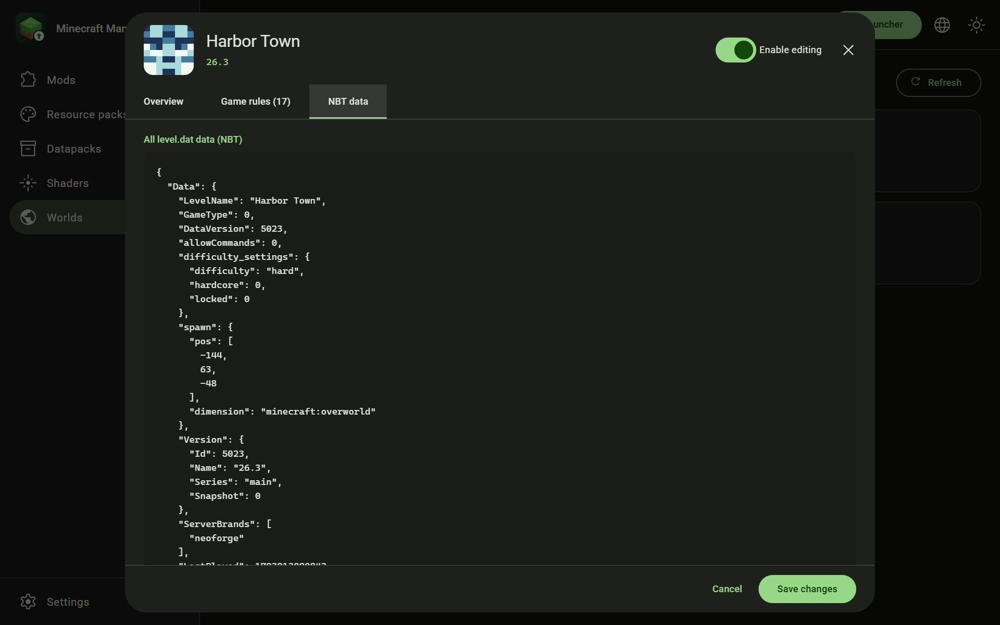
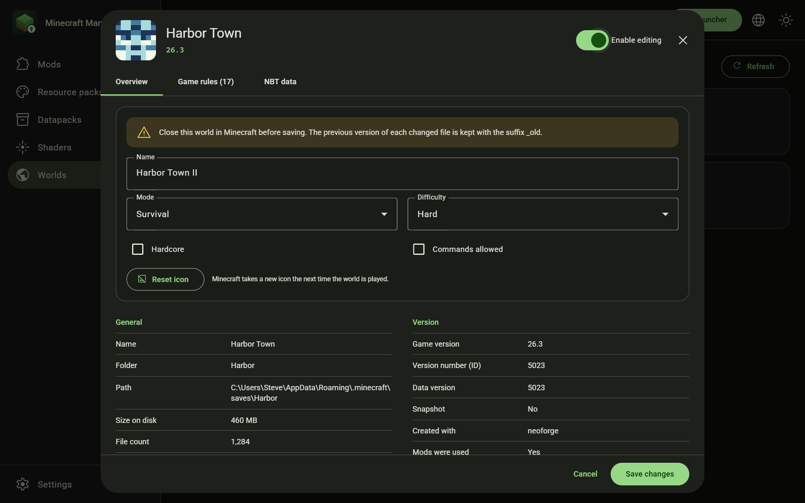
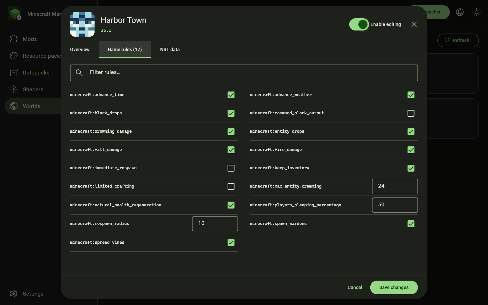
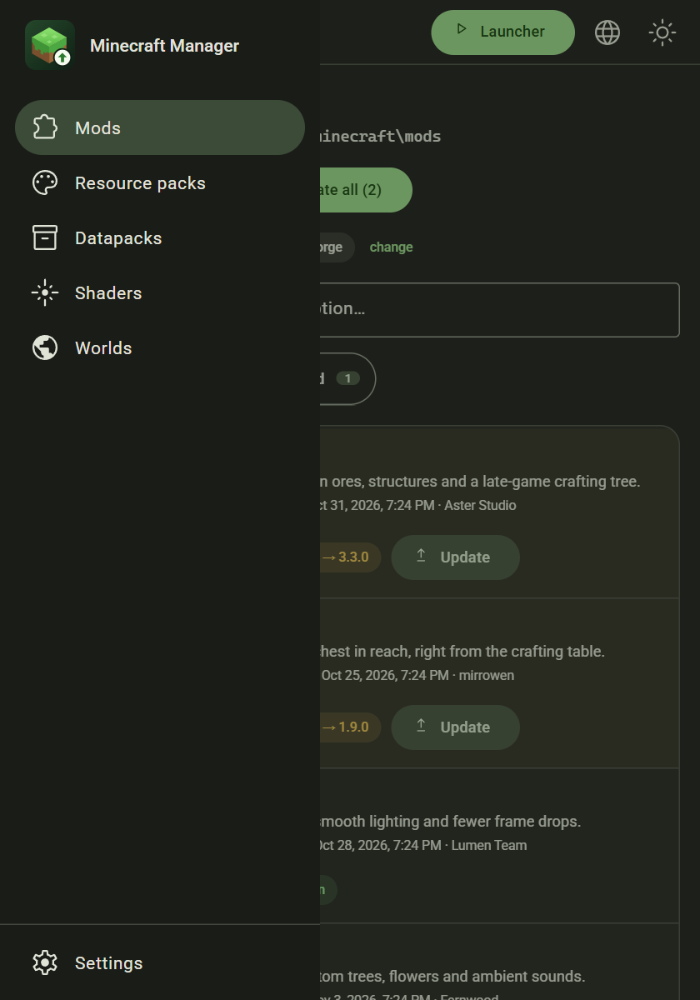

<p align="center">
  
</p>

<h1 align="center">Minecraft Manager</h1>

See everything installed in your Minecraft, get names, icons and versions from Modrinth or CurseForge, update mods, resource packs, shaders and datapacks with one click, view and edit your worlds, and start Minecraft Launcher.

You can use it as a [desktop app](#desktop-app) or as a [web app](#web-app) in your browser.



<sub>All screenshots use made-up demo data.</sub>

## Features

- **Everything in one place:** mods, resource packs, datapacks (including those inside worlds), shaders and worlds.
- **Names, icons and versions** from Modrinth or CurseForge. Files are recognized by their hash, even when renamed.
- **Updates with one click**, for one item or all of them. Downloads are checksum-verified and the old file is backed up.
- **Search and filters** to find an item, or to show only items with updates or unrecognized files.
- **World details** read from `level.dat`: general, version, game and player information, game rules and the full NBT tree.
- **World editing:** name, game mode, difficulty, hardcore, commands and game rules, plus resetting the icon. It's off by default and backs up every file it changes. See [Edit a world](#edit-a-world).
- **Start Minecraft Launcher** from the top bar.
- **Light and dark themes, and 19 languages.** The layout adapts to narrow windows.
- **Local:** no account and no database. Settings and caches are local JSON files.

## Built with

- **Backend:** Spring Boot 3.5, Java 21
- **Frontend:** Angular 21 with Angular Material (Material 3)
- **Desktop:** Electron, with Java included

## Desktop app

### Install a release

Java, Docker and a database are not needed. Get the installer for your system from the [latest release](https://github.com/YValerii/minecraft-manager/releases/latest):

| System | File |
|---|---|
| Windows 10/11 | `minecraft-manager-<version>-win-x64.msi` or `minecraft-manager-<version>-win-x64.exe` |
| macOS, Apple Silicon | `minecraft-manager-<version>-mac-arm64.dmg` |
| macOS, Intel | `minecraft-manager-<version>-mac-x64.dmg` |
| Linux | `minecraft-manager-<version>-linux-x86_64.AppImage` or `minecraft-manager-<version>-linux-amd64.deb` |

The installers aren't code-signed yet, so the first launch needs one extra step:

- **Windows:** on the SmartScreen warning, choose "More info", then "Run anyway".
- **macOS:** drag the app to Applications, then run `xattr -cr "/Applications/Minecraft Manager.app"` in Terminal. Without this, macOS reports the app as damaged.
- **Linux AppImage:** run `chmod +x` on the file first. On Ubuntu 24.04 and later, also start it with `--no-sandbox`, or install the `.deb` instead.

Settings are stored in `%APPDATA%\Minecraft Manager` on Windows, `~/Library/Application Support/Minecraft Manager` on macOS and `~/.config/Minecraft Manager` on Linux.

### Build and run from source

You need:

- **JDK 21.** A JRE isn't enough, because the build uses `jlink`. Either put the JDK's `bin` folder on your `PATH` or set `JAVA_HOME` to the JDK folder.
- **Node.js 22.12 or newer.** An LTS version is recommended.

```bash
cd desktop
npm ci
npm run build:resources   # builds the UI, the backend and a trimmed Java runtime
npm start                 # runs the app without packaging it
```

Run `npm run build:resources` again after changing the frontend or backend.

To build an installer for the OS you're on (installers can't be cross-built), run this after `build:resources`:

```bash
npm run dist              # writes the installer to desktop/dist
```

## Web app

Pick whichever suits you. All three serve the same UI in your browser.

| Way to run | Needs | Address | Launcher button |
|---|---|---|---|
| [Release jar](#release-jar) | Java 21+ | http://localhost:8080 | Yes |
| [Docker](#docker) | Docker | http://localhost:4200 | No |
| [From source](#from-source) | JDK 21, Node.js 22.12+ | http://localhost:4200 | Yes |

### Release jar

Download `minecraft-manager-<version>.jar` from the [latest release](https://github.com/YValerii/minecraft-manager/releases/latest), then run:

```bash
java -jar minecraft-manager-<version>.jar
```

Your browser opens http://localhost:8080. Add `--server.port=9000` if that port is taken, and press Ctrl+C in the terminal to stop. Settings are saved in a `data` folder in the directory you run it from.

To build this jar yourself:

```bash
cd frontend
npm ci
npm run build
cd ../backend
./mvnw -Pbundle-ui clean package      # Windows: .\mvnw.cmd -Pbundle-ui clean package
```

The jar is written to `backend/target/desktop/`.

### Docker

```bash
docker compose up --build
```

Then open http://localhost:4200.

On Windows, `%APPDATA%\.minecraft` is mounted into the container by default. On other systems, or with a non-standard location, copy `.env.example` to `.env` and set the folder:

```env
MINECRAFT_DIR=C:/Users/Name/AppData/Roaming/.minecraft
# Linux:  MINECRAFT_DIR=/home/user/.minecraft
# macOS:  MINECRAFT_DIR=/Users/user/Library/Application Support/minecraft
```

The folder is mounted with write access, otherwise updates aren't possible.

The launcher button is disabled in Docker, because a container can't start programs on your computer.

### From source

For development, run the backend and frontend in two terminals. The frontend reloads on changes and proxies `/api` to the backend.

```bash
cd backend
./mvnw spring-boot:run                # Windows: .\mvnw.cmd spring-boot:run
```

```bash
cd frontend
npm install
npm start
```

Then open http://localhost:4200. The backend runs on http://localhost:8080.

## How to use it

### First-time setup

Open **Settings** and check these, then save:

- **Minecraft installation path.** Leave the default unless your game is somewhere else.
- **Minecraft version and mod loader.** Updates are only looked up for these. The defaults are 26.3 and neoforge.
- **Source.** Modrinth works without a key. CurseForge needs a free API key from https://console.curseforge.com.

The folders for mods, resource packs, shaders, datapacks and saves can be changed there too. The bottom of the page shows where each one resolves to, and whether it exists.



### Browse what's installed

| Tab | What it shows |
|---|---|
| Mods | `mods/*.jar` |
| Resource packs | `resourcepacks/*.zip` and folders |
| Datapacks | `datapacks/` and `saves/<world>/datapacks/`, tagged with the world |
| Shaders | `shaderpacks/*.zip` and folders |
| Worlds | One tile per world, with its icon, version, game mode and when it was last played. Click a tile for [its details](#world-details). |

Use the search box and the filters to narrow a list down to items with updates or unrecognized items. Items with an update stand out, and hovering over the update badge shows the start of the changelog.

Files are identified by their hash, not their name, so a renamed file is still recognized. If a file isn't on Modrinth or CurseForge, such as a custom build or a folder pack, it's marked "Unrecognized" and shows the details stored inside the file instead.



### Update

Close the game first, then:

1. Open a tab and click **Check for updates**.
2. Click **Update** on one item, or **Update all**.

Each update is downloaded to a temporary file and its checksum is verified before anything is replaced. The old file is moved to `.minecraft/.mc-manager-backup/<type>/<date-time>/`, so you can restore it from there by hand.

Some CurseForge authors disallow downloads through the API. The app then tries the public CDN, and if that fails too, the file has to be downloaded manually.

### World details



Click a world to open its details, read from its NBT data. The window has up to three tabs:

| Tab | What it shows |
|---|---|
| Overview | General details, version, game settings, the player, and datapacks and features. Anything unknown is left out. |
| Game rules | Every game rule stored in the world, with a box to filter them by name. Worlds without game rules don't have this tab. |
| NBT data | The full contents of `level.dat` as JSON, loaded when you open the tab. |





### Edit a world

Worlds can't be changed by accident. Editing is off every time you open a world, until you turn on the **Enable editing** switch. Saving or cancelling turns it off again.

Close the world in Minecraft first, then change any of these and click **Save changes**:

| What | Where it's saved |
|---|---|
| Name | `LevelName` in `level.dat` |
| Game mode | `GameType` in `level.dat`, and the mode of every player in the world's player files |
| Difficulty | `level.dat` |
| Hardcore | `level.dat` |
| Commands allowed | `allowCommands` in `level.dat` |
| Game rules | `level.dat` or, in newer worlds, `data/minecraft/game_rules.dat` |



On/off game rules get a checkbox and numeric ones a number field. Rules with any other value get a text field.



**Reset icon** deletes the world's `icon.png`, so that Minecraft takes a new one the next time the world is played. It asks first, and takes effect straight away rather than waiting for **Save changes**.

A few things keep your world safe:

- **Only what you changed is written.** All other NBT data stays as it was, including data this app doesn't know about, such as data from mods.
- **Open worlds are refused.** If Minecraft is using the world, saving fails with a message, nothing is changed, and your edits stay in the form so you can try again.
- **Backups.** The previous version of each changed file is kept next to it with the suffix `_old`, for example `level.dat_old`. Each save replaces the backup from the save before it.
- **Unsaved edits aren't lost silently.** Cancelling or closing the window asks first.

To undo a save by hand, make sure Minecraft isn't using the world, then rename the `_old` file back to its original name.

### Start Minecraft

Click **Launcher** in the top bar to open the official Minecraft Launcher. It's found automatically in these places:

| System | Locations |
|---|---|
| Windows | Microsoft Store / Xbox app install, `Program Files\Minecraft Launcher`, `Program Files (x86)\Minecraft Launcher` |
| macOS | `/Applications/Minecraft.app`, `~/Applications/Minecraft.app` |
| Linux | `minecraft-launcher` on your `PATH`, `/opt/minecraft-launcher`, Flatpak `com.mojang.Minecraft` |

If the launcher can't be found, the button is disabled. For a launcher in another location, set the `APP_LAUNCHER_PATH` environment variable to its full path and restart the app.

### Theme and language

Click the sun or moon button in the top bar to switch between light and dark. The app starts with your system's preference until you choose one. Click the globe button beside it to pick one of 19 languages. Both choices are remembered.

### Narrow windows

On narrow windows the navigation moves into a drawer, which opens from the menu button in the top bar.



## Configuration

These environment variables configure the backend. `APP_MINECRAFT_PATH` to `CURSEFORGE_API_KEY` are only initial values: after the first run they live in `settings.json` in `APP_DATA_DIR` and are changed on the **Settings** page.

| Variable | Default | Purpose |
|---|---|---|
| `APP_MINECRAFT_PATH` | `%APPDATA%\.minecraft` or `~/.minecraft` | Minecraft folder |
| `APP_GAME_VERSION` | `26.3` | Game version for updates |
| `APP_LOADER` | `neoforge` | Mod loader for updates |
| `APP_PROVIDER` | `MODRINTH` | `MODRINTH` or `CURSEFORGE` |
| `CURSEFORGE_API_KEY` | empty | CurseForge API key |
| `APP_DATA_DIR` | `./data` | Where settings and caches are stored |
| `APP_LAUNCHER_PATH` | empty | Launcher location, read on every start. Empty means detect it automatically. |

## REST API

```
GET  /api/settings          PUT /api/settings          GET /api/settings/paths
GET  /api/content/{mods|resourcepacks|datapacks|shaderpacks}[?refresh=true]
GET  /api/content/{type}/updates[?refresh=true]
POST /api/content/{type}/install        {"id": "mods/foo.jar"}
POST /api/content/{type}/install-all
GET  /api/content/{type}/icon?id=...
GET  /api/worlds     GET /api/worlds/{folder}     GET /api/worlds/{folder}/raw     GET /api/worlds/{folder}/icon
PATCH  /api/worlds/{folder}             {"name": "...", "gameMode": "creative", "difficulty": "hard", "hardcore": false, "allowCommands": true, "gameRules": {"minecraft:keep_inventory": "true"}}
DELETE /api/worlds/{folder}/icon
GET  /api/launcher          POST /api/launcher/launch  {}
```

`PATCH` only changes the fields you send. It and `DELETE` return the world as it now is, or `409` if the world is open in Minecraft.

The API has no login, so it only listens on your own computer unless you change `SERVER_ADDRESS`.

## Project structure

```
backend/    Spring Boot (settings, content, provider, world, launcher)
frontend/   Angular 21 + Angular Material + nginx (proxies /api to the backend)
desktop/    Electron wrapper and installer build
docs/       Screenshots for this file
docker-compose.yml
```

## Tests

```bash
# Backend (coverage report: backend/target/site/jacoco/index.html)
cd backend
./mvnw verify

# Frontend (coverage report: frontend/coverage/)
cd frontend
npm test
npm run test:coverage
```

GitHub Actions runs both, plus the frontend build, on every pull request to `main` (`.github/workflows/ci.yml`). To make them required before merging, import `.github/rulesets/main-required-checks.json` under **Settings → Rules → Rulesets → New ruleset → Import a ruleset**.

Tests marked `@Disabled` (backend) or `it.fails` (frontend) describe known bugs: they state the correct behaviour, so remove the marker when you fix the bug.

## Releases

Pushing a `release/**` branch builds and tests all installers in GitHub Actions. Pushing a `v*` tag that matches the version in `desktop/package.json` also publishes them as a GitHub release.
